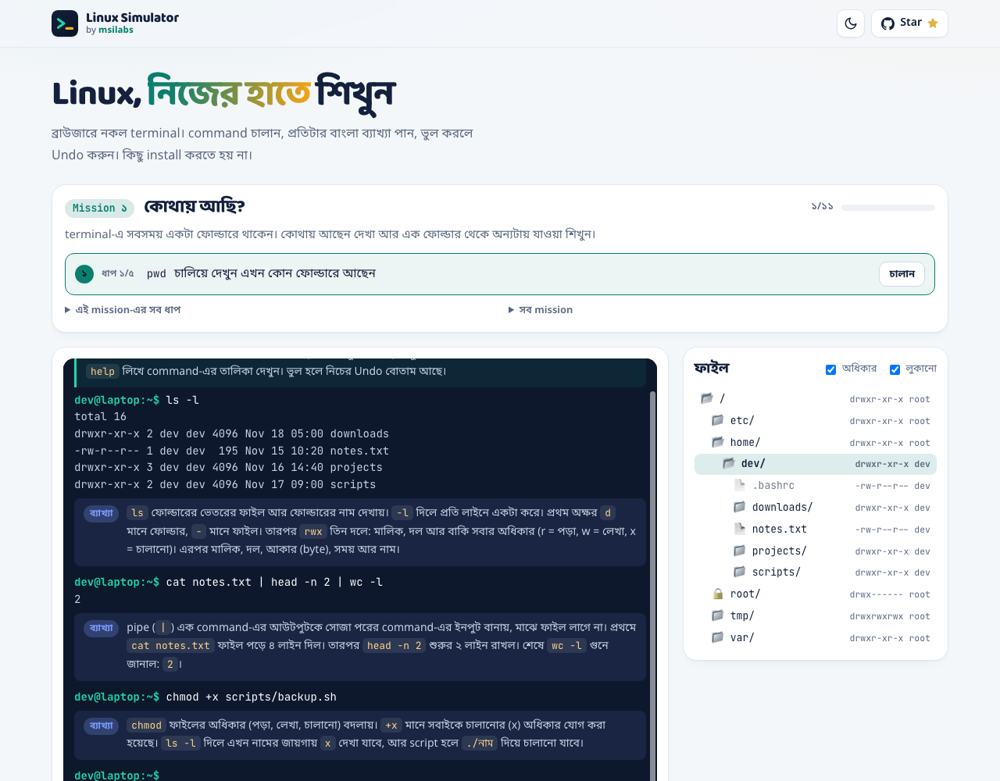
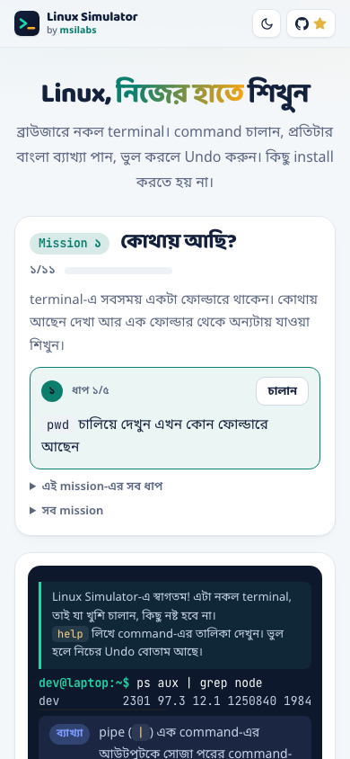

# Linux Simulator

ব্রাউজারে নকল Linux terminal। `cd`, `ls`, `grep`, `chmod`, pipe নিজের হাতে চালান, প্রতিটা command-এর পরে বাংলায় বলে দেয় কী হলো আর কেন। কিছু install করতে হয় না, ভুল করলে Undo আছে, আপনার লেখা কোথাও পাঠানো হয় না।

🔗 **লাইভ:** https://msilabs.github.io/linux-simulator/



## কী কী আছে

- **বাংলা ব্যাখ্যা:** প্রতিটা command-এর পরে ছোট ব্যাখ্যা। `pipe` থাকলে ধাপে ধাপে বলে: "প্রথমে `cat` ৪ লাইন দিল, তারপর `head` ২ লাইন রাখল, শেষে `wc -l` গুনে জানাল"। ভুল হলে বলে কেন হলো আর কী করতে হবে (যেমন `Permission denied` এলে কোন অধিকার নেই)।
- **৪৮টা command:** `ls cd pwd tree mkdir rmdir touch cat echo cp mv rm head tail wc grep find sort uniq cut less chmod chown sudo whoami id ps kill du df ln nano date uname hostname sleep env export unset alias unalias which man history clear help true false`।
- **shell:** pipe (`|`), redirect (`> >> < 2> 2>&1`), `&& || ;`, `$VAR`, `~`, glob (`* ? [abc]`), alias, আর `./script.sh`।
- **১১টা mission, ৫০টা ধাপ:** "কোথায় আছি?" থেকে "log থেকে সমস্যা খোঁজা" পর্যন্ত। ধাপ পূর্ণ হয় ফল দেখে, হুবহু লেখা মিলিয়ে নয়, তাই `mkdir -p a/b` আর `mkdir a && mkdir a/b` দুটোই চলে।
- **ফাইল গাছ:** পাশে সব ফাইল, অধিকারসহ। command চালালে নতুন আর বদলানো ফাইল কিছুক্ষণ রঙিন থাকে, মোছা জিনিসের নাম বার্তায় আসে। ফাইলে click করলে লেখা দেখা যায়।
- **অধিকার সত্যিই কাজ করে:** `chmod 000` দিলে নিজেও পড়তে পারবেন না, script-এ `x` না থাকলে `./backup.sh` চলে না, `root`-এর ফোল্ডারে `sudo` ছাড়া ঢোকা যায় না।
- **ভয় ছাড়া ভুল করা:** Undo আর "শুরু থেকে"। `rm -rf /`, `rm -rf ~`, `chmod -R 777 /` আটকে দিয়ে বুঝিয়ে বলে আসল server-এ কী হতো।
- **process:** `ps aux`, `kill`, আর আটকে থাকা একটা `node server.js` যেটা ভদ্রভাবে (`kill`) মরে না, `kill -9` লাগে। `tail -f` চলতে থাকে, Ctrl+C বা বোতামে থামে।
- **`nano`:** নিচে editor খোলে। সেভ করলে ফাইল বদলায়, Undo দিয়ে ফেরানো যায়।
- **বাংলা `man`:** `man grep` দিলে বাংলায় বিবরণ, option আর উদাহরণ।
- **অগ্রগতি থাকে:** রিলোড করলেও আগের জায়গাতেই ফেরেন, শুধু আপনার browser-এ সেভ হয়।
- **মোবাইলে চলে:** keyboard-এ খুঁজে না পাওয়া `| ~ / - > * Tab ↑ Ctrl+C`-এর জন্য আলাদা key bar। আলো আর অন্ধকার থিম।



## চালানো

সাইট বানানো হয় [আলো (Alo)](https://github.com/msilabs/alo) দিয়ে। Node.js ২২ বা নতুন ভার্সন লাগবে।

```bash
npm install
npm run dev     # http://localhost:3000
npm run build   # dist/ ফোল্ডারে সাইট
npm test        # engine, mission, আসল bash-এর সাথে তুলনা আর browser test
```

GitHub Pages-এর মতো সাব-পাথের জন্য: `node alo build --base /linux-simulator/`

## কীভাবে কাজ করে

পুরো simulator সাধারণ JavaScript। `global/`-এর ফাইলগুলো নামের ক্রমে একটা script হয়ে জোড়া লাগে, আর `90-app.js` ছাড়া কোনোটাই DOM ছোঁয় না, তাই Node-এও `require` করে test করা যায়।

```
global/
  01-path.js       path: ~, ., .., একাধিক /
  02-fs.js         নকল file system, অধিকার যাচাই, symlink
  03-seed.js       শুরুর ফাইল আর process (প্রতিবার হুবহু একই)
  04-parser.js     লেখা ভেঙে tree: quote, pipe, redirect, && || ;
  05-expand.js     ~, $VAR, glob
  06-text.js       UI-র বাংলা লেখা
  08-helpers.js    result বানানো, flag পড়া, path খোঁজা
  09-registry.js   command-এর তালিকা
  10-commands/     প্রতিটা command (pure function)
  20-shell.js      এক লাইন চালানো: pipe, redirect, alias, script
  21-explain.js    বাংলা ব্যাখ্যা
  22-complete.js   Tab completion
  23-man.js        বাংলা manual
  25-missions.js   mission আর ধাপ যাচাই
  30-session.js    undo, replay, Ctrl+C, editor সেভ
  32-storage.js    localStorage-এ সেভ আর যাচাই
  33-filetree.js   ফাইল গাছের সারি আর বদলের হিসাব
  90-app.js        DOM: terminal, গাছ, mission panel, key bar, editor
  style.css        সব CSS
tests/             node --test
tools/og.html      শেয়ারের ছবির নকশা
```

কয়েকটা সিদ্ধান্ত:

- **state immutable।** প্রতিটা command নতুন state ফেরত দেয়, পুরোনোটা বদলায় না। তাই Undo সহজ।
- **পুরো state সেভ হয় না।** সেভ হয় শুরুর state আর state-বদলানো command-এর তালিকা। রিলোডে সেগুলো আবার চালিয়ে হুবহু একই অবস্থা ফিরে আসে। তালিকা ২০০ ছাড়ালে পুরোনো অংশ শুরুর state-এ ঢুকে যায়।
- **নকল ঘড়ি।** `ls -l`-এর সময় আসে একটা ক্রমিক গণনা থেকে, তাই ফল সবসময় একই।
- **pipe-এর প্রতিটা ধাপ subshell।** ধাপের ভেতরে `cd` বা `export` করলে বাইরে পড়ে না, তবে ফাইলের বদল থাকে, ঠিক আসল shell-এর মতো।
- **সাজানোর নিয়ম Ubuntu-র।** চিহ্ন আগে, তারপর অঙ্ক, তারপর অক্ষর, বড়-ছোট হাতের ভেদ প্রথমে ধরা হয় না।

## test

`npm test` চালায়:

- **unit test:** path, file system, parser, প্রতিটা command, session, undo, সেভ।
- **mission test:** প্রতিটা ধাপ নিজের প্রস্তাবিত command-এ শেষ হয় কিনা, আর অন্য সঠিক উপায়েও হয় কিনা।
- **আসল bash-এর সাথে তুলনা** (`tests/bash-compare.test.mjs`): ১১০টারও বেশি command আসল `bash` আর সিস্টেমের tool-এ চালিয়ে `stdout`, `stderr` আর exit code মেলানো হয়। শুধু Linux-এ চলে, CI-তে `ubuntu-latest`-এ। অন্য জায়গায় skip হয়।
- **browser test** (`tests/e2e.test.mjs`): আসল Chrome-এ পুরো পেজ। Chrome না থাকলে skip। কোনো বাড়তি package লাগে না।

## নতুন কিছু যোগ করা

- **command:** `global/10-commands/`-এর কোনো ফাইলে `Registry.register('নাম', { desc, run })` লিখুন। `run` পায় `{ state, args, stdin, tty }` আর ফেরত দেয় `{ state, stdout, stderr, code, errno }`। বাংলা ব্যাখ্যা যোগ করুন `21-explain.js`-এ, `man` page `23-man.js`-এ, আর test লিখুন।
- **mission:** `25-missions.js`-এর তালিকায় যোগ করুন। নতুন ধাপ শুধু শেষে বসান, নাহলে পুরোনো সেভের অগ্রগতি অন্য ধাপে চলে যাবে।
- **শুরুর ফাইল:** `03-seed.js`। বদলালে mission আর test ঠিক আছে কিনা দেখুন।

উদাহরণে কারো আসল ফোন নম্বর বা IP দেবেন না। `01712345678`-এর মতো ক্রমিক নম্বর আর `192.0.2.x`, `198.51.100.x`, `203.0.113.x` ব্যবহার করুন।

## যা নেই

`$(...)`, backtick, `if`, `for`, function, here-doc আর `&` (background job) নেই, চালালে বাংলায় বলে দেয়। `ssh`, `apt`, `curl`, `vim`, `cron` নেই। একাধিক user-এর login নেই, `sudo` শুধু এক command-এর জন্য root।

## লাইসেন্স

MIT। [msilabs](https://msilabs.github.io)-এর অংশ।
